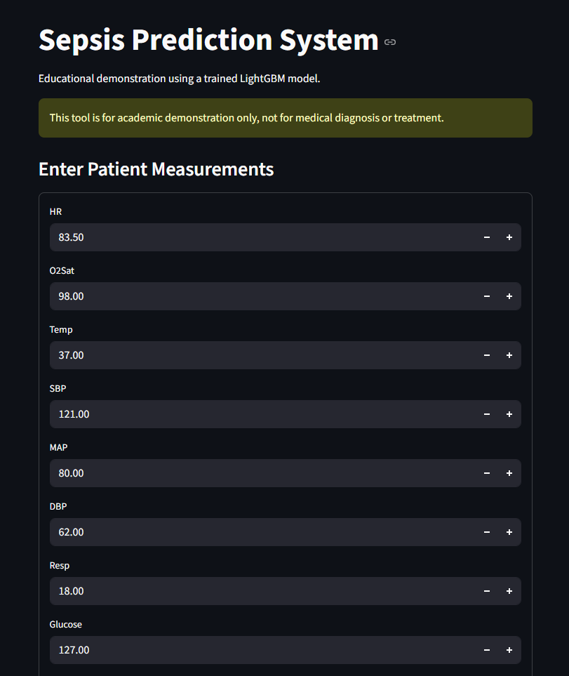
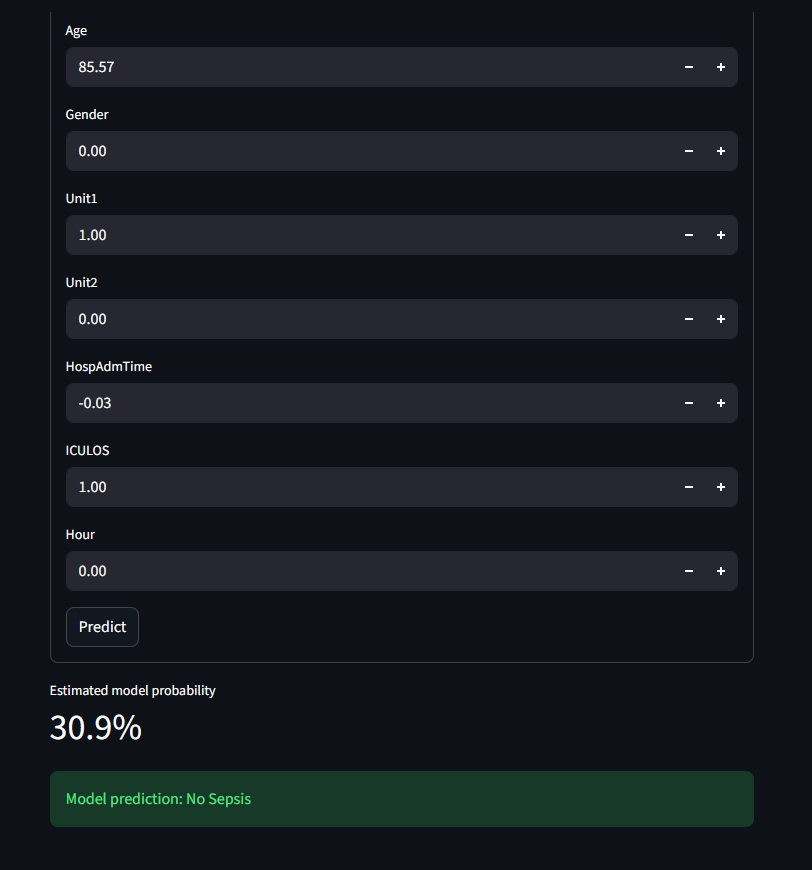
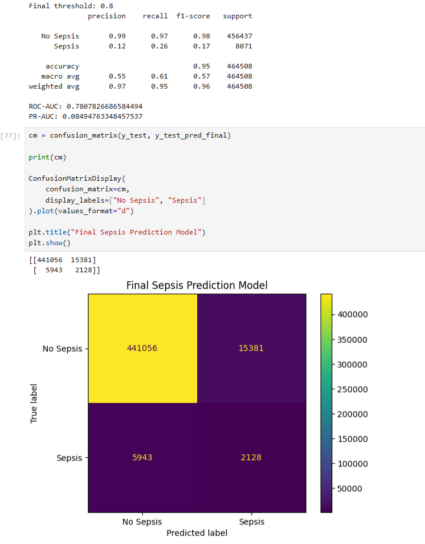

# Sepsis Prediction Using Machine Learning

## Project Overview

This project explores the use of machine learning to identify sepsis-related patterns from clinical data. It uses the PhysioNet 2019 Challenge dataset, a LightGBM classification model, and a Streamlit application for interactive predictions.

The project focuses on data preprocessing, handling class imbalance, model evaluation, threshold selection, and creating a simple user interface.

> **Disclaimer:** This is an academic project for educational purposes only. It is not a clinically validated diagnostic tool and must not be used for medical decisions.

## Objectives

- Explore and preprocess clinical data.
- Handle missing values in clinical measurements.
- Develop a LightGBM classification model.
- Address class imbalance during training.
- Evaluate model performance using multiple classification metrics.
- Examine the precision-recall trade-off when selecting a classification threshold.
- Build a Streamlit interface to demonstrate model predictions.

## Technologies Used

- **Python** — model development and data processing
- **Pandas and NumPy** — data manipulation
- **Scikit-learn** — data splitting and model evaluation
- **LightGBM** — machine learning model
- **Jupyter Notebook** — experimentation and analysis
- **Streamlit** — interactive application
- **Joblib** — saving and loading model artifacts

## Dataset

This project uses the **PhysioNet/Computing in Cardiology Challenge 2019** dataset.

Dataset source: https://physionet.org/content/challenge-2019/

The dataset contains hourly clinical measurements and sepsis labels.

The dataset files are not included in this repository. Users should obtain the data from the official source and follow its access requirements and usage conditions.

## Project Workflow

1. **Data Loading:** Load and combine the available clinical records.
2. **Exploratory Data Analysis:** Examine dataset dimensions, class distribution, and missing values.
3. **Data Preprocessing:** Prepare features and handle missing values using imputation.
4. **Patient-wise Data Splitting:** Separate training, validation, and test records by patient to reduce data leakage.
5. **Class Imbalance Handling:** Use LightGBM's `scale_pos_weight` parameter to give more weight to the minority class during training.
6. **Model Training:** Train a LightGBM classification model and adjust selected hyperparameters.
7. **Model Evaluation:** Assess performance using precision, recall, F1-score, ROC-AUC, PR-AUC, and the confusion matrix.
8. **Threshold Selection:** Explore different classification thresholds to understand the trade-off between precision and recall.
9. **Application Development:** Use Streamlit to demonstrate predictions from the saved model.

## Machine Learning Model

The project uses **LightGBM**, a gradient boosting algorithm based on decision trees.

LightGBM was selected because it is designed for efficient training on large tabular datasets.

The model uses clinical features such as:

- Heart rate
- Oxygen saturation
- Temperature
- Blood pressure measurements
- Respiratory rate
- Glucose
- Age and gender
- Hospital admission time
- ICU length of stay
- Other available clinical indicators

The target variable is `SepsisLabel`.

## Model Evaluation

The model is evaluated using several metrics because the dataset has a highly imbalanced target distribution.

| Metric | Purpose |
|---|---|
| Precision | Measures the proportion of predicted positive records that are actually positive |
| Recall | Measures the proportion of actual positive records correctly identified |
| F1-score | Combines precision and recall |
| ROC-AUC | Measures discrimination across classification thresholds |
| PR-AUC | Summarizes the precision-recall trade-off |
| Confusion Matrix | Shows true positives, true negatives, false positives, and false negatives |

### Reported Evaluation Results

One reported evaluation at a classification threshold of 0.8 produced the following results:

| Metric | Result |
|---|---:|
| Accuracy | Approximately 95.4% |
| Precision for sepsis | Approximately 12.2% |
| Recall for sepsis | Approximately 26.4% |
| F1-score for sepsis | Approximately 17.0% |
| ROC-AUC | Approximately 0.781 |
| PR-AUC | Approximately 0.085 |

These values correspond to a particular model evaluation and threshold. Results can differ when the model, data split, or threshold changes.

Accuracy should not be interpreted alone because sepsis-positive records are relatively rare. Precision and recall are important for understanding false alarms and missed positive records.

## Streamlit Application

The project includes a Streamlit application that:

- Loads the saved model and configuration files.
- Accepts clinical measurements through input fields.
- Generates a model score for the entered record.
- Displays a prediction based on the configured threshold.

### Screenshots

#### 1. Streamlit Application — Patient Measurements



#### 2. Streamlit Application — Prediction Result



#### 3. Model Evaluation — Classification Report and Confusion Matrix



*Note: The screenshot filenames and paths must match the actual files uploaded to the `screenshots` folder in this repository.*

## How to Run the Project

### 1. Clone the repository

```bash
git clone https://github.com/devasribalu29/Sepsis-Prediction-ML.git
cd Sepsis-Prediction-ML
```

### 2. Create a virtual environment (recommended)

```bash
python -m venv .venv
```

On Windows:

```bash
.venv\Scripts\activate
```

### 3. Install dependencies

```bash
pip install -r requirements.txt
```

### 4. Ensure the model files are available

The following files must be available in the project directory for the application to run:

- `sepsis_prediction_model.pkl`
- `sepsis_feature_columns.pkl`
- `sepsis_threshold.pkl`

### 5. Start the Streamlit application

```bash
streamlit run app.py
```

The terminal will display a local URL that you can open in your browser.

## Repository Structure

```text
Sepsis-Prediction-ML/
├── CAPSTONE2.ipynb
├── app.py
├── sepsis_prediction_model.pkl
├── sepsis_feature_columns.pkl
├── sepsis_threshold.pkl
├── requirements.txt
├── README.md
├── .gitignore
└── screenshots/
    ├── streamlit_inputs.png
    ├── streamlit_prediction.png
    └── model_evaluation.png
```

## Limitations and Future Improvements

- The model is an academic prototype and has not been clinically validated.
- Class imbalance makes reliable detection of positive cases challenging.
- The model score should not be interpreted as a calibrated clinical probability unless calibration has been assessed.
- Performance should be validated on independent data before considering any real-world application.
- Future work could compare LightGBM with Logistic Regression and Random Forest using the same patient-wise split.
- Further work could explore calibration, threshold selection, and external validation.

## References

1. Reyna, M. A., et al. (2020). *Early Prediction of Sepsis From Clinical Data: The PhysioNet/Computing in Cardiology Challenge 2019.* Critical Care Medicine, 48(2), 210–217. https://pmc.ncbi.nlm.nih.gov/articles/PMC6964870/
2. Ke, G., et al. (2017). *LightGBM: A Highly Efficient Gradient Boosting Decision Tree.* Advances in Neural Information Processing Systems. https://proceedings.neurips.cc/paper/2017/hash/6449f44a102fde848669bdd9eb6b76fa-Abstract.html

## Author

**Devasri B**

GitHub: https://github.com/devasribalu29

---

*Developed as an academic machine learning capstone project.*
